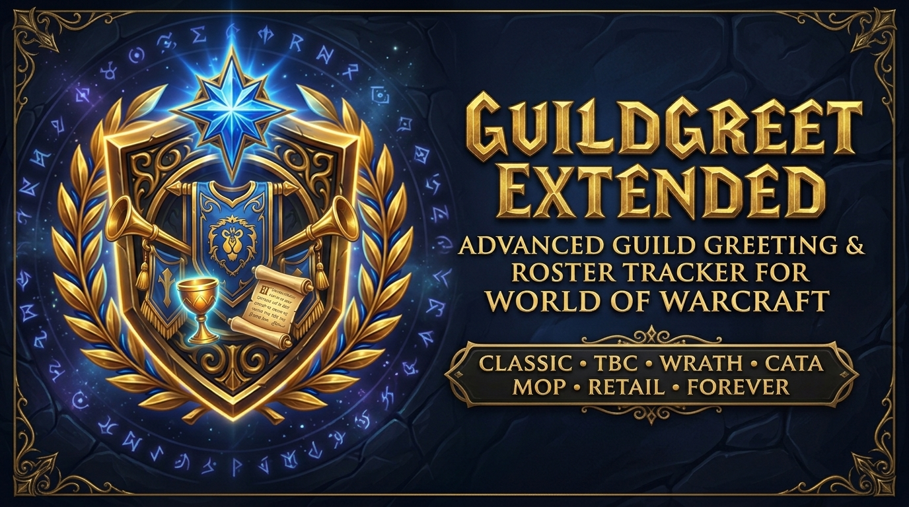

  

  # GuildGreet Extended

  **The Ultimate Guild, Friends & Channel Greeting Assistant for World of Warcraft — Completely Rebuilt on Ace3 with a Modern Dark-Slate & Gold UI!**

  
  
  
  
  
  
  
  
  

---

**GuildGreet Extended** is a comprehensive World of Warcraft social guild, friends, and channel greeting assistant with full **Main / Alt (Twink) & Alias management**, customizable greeting collections, an interactive floating greeting queue, and a modern **Dark-Slate & Gold UI** with live font scaling (`10pt – 18pt`) — completely rewritten on the **Ace3 framework**.

---

## 🎮 Supported WoW Versions

Supports **all World of Warcraft flavors** from a single unified codebase:
- **Retail (Midnight `12.x` & The War Within `11.2.x`)**
- **Mists of Pandaria Classic (`5.5.x`)**
- **Cataclysm Classic (`4.4.x`)**
- **Wrath of the Lich King Classic (`3.4.x` / `3.8.x`)**
- **The Burning Crusade Classic Anniversary (`2.5.x`)**
- **Classic Era (`1.15.x`) & Classic Forever (`1.60.x` / `16001`)**

---

## ✨ Key Features

### 🎨 Complete Ace3 Rewrite & Modern Dark-Slate & Gold UI (`v13.0.0`)
- **Built on Ace3**: Powered by `AceAddon-3.0`, `AceDB-3.0`, `AceGUI-3.0`, `AceEvent-3.0`, `AceTimer-3.0`, `AceLocale-3.0`, `AceSerializer-3.0`, `AceComm-3.0`, `LibSharedMedia-3.0`, `LibDataBroker-1.1`, and `LibDBIcon-1.0`.
- **Unified Configuration Window (`/gg` or `/guildgreet`)**: Clean navigation (`General`, `Greetings`, `Characters`, `Sub-Window`, `Cleanup`, `Backup & Restore`, `Information`) plus full **AceDB-3.0 Profile Management** (`Default`, Character, Realm, Class, or Custom profiles).
- **Live UI Font Scaling (`10pt – 18pt`)**: Instant `A-` / `A+` buttons in the window header and a font selector (`LibSharedMedia-3.0`) dynamically scale all text, labels, buttons, inputs, and the floating in-game greeting queue.
- **Persistent Window & Queue Positions**: Both the main configuration window (`GuildGreetConfigFrame`) and the floating greeting queue (`GuildGreetList`) automatically save and restore their exact screen coordinates when dragged.
- **ElvUI & AddOnSkins Compatible**: Custom backdrop and checkbox/button textures work cleanly alongside ElvUI and AddOnSkins without missing checkmarks, double borders, or clipped text.
- **Minimap Button & Addon Compartment**: Built-in `LibDBIcon-1.0` minimap launcher and Retail Addon Compartment integration.

### 📋 Interactive Floating Greeting Queue (`GuildGreetList`)
- Displays guild members, friends, and channel members who just logged in, relogged, joined the guild, leveled up, earned an achievement, or got promoted.
- **Left-Click** an entry to send a context-aware greeting, welcome, or congratulation message; **Right-Click** to dismiss the entry from the queue.
- **Rich Hover Tooltips**: Shows Main/Alt associations, aliases, level, class, guild rank, public/officer notes, online/offline timestamps, and event badges (`NEW`, `LVL`, `RANK`, `ACHV`).
- Configurable growth direction (upward or downward), maximum visible entries (`1–15`), custom row dimensions, and persistent drag position.

### 👥 Main / Alt (Twink) & Alias Management
- Link any number of alt characters to a player's **Main** character and assign custom **Aliases** (nicknames) and personal notes.
- **Automatic Guild Note Parsing**: Optionally auto-assigns Main/Alt links and aliases from public and officer guild notes (supports standard notations as well as EGP / GuildAds tags).
- **Chat Enhancement**: Optionally prepends `{Main}` or `{Alias}` tags to guild, officer, whisper, and channel messages so you always know who you are talking to.
- **Roster Inspector & Filters**: Search and filter your character database by name, alias, main, note, guild, online status, unassigned characters, or ignored players.

### 💬 16 Greeting Categories & Custom Collections
- **16 Specialized Message Categories**:
  - `Greet` (Login), `GreetBack` (Relog), `Welcome` (Joined Guild), `NewRank` (Promotion), `NewLevel` (Level-Up), `Achievment` (Achievement), `Bye` (Logout Day), `Night` (Logout Night), `Guild` / `Channel` (Self Login), `ByeGuild` / `ByeChannel`, `NightGuild` / `NightChannel`, `LaterGuild` / `LaterChannel`.
- **Custom Collections**: Create reusable message collections and assign them globally, per **Realm**, per **Guild**, or per **Character**.
- **Dynamic Placeholders & Conditional Filters**: Use `%s`, `%c`, `%m`, `%a`, `%A`, `%l`, `%L`, `%C`, `%r`, `%v`, `%g`, `%G` and restrict messages by level range (`<min:max>`) or time of day (`<HH:MM:HH:MM>`).

### 🧹 Database Maintenance, Plausibility Checks & Safe Backups
- **Consistency & Plausibility Checker**: Detects and automatically repairs orphaned alt links, circular references, and missing main flags.
- **Database Cleanup Tools**: Prune orphaned characters, guildless characters, or stale guild/channel/friend references.
- **Safe Snapshots & Export/Import**: Create/restore local database backups (`GLDG_DataBackup`) or share settings via `AceSerializer-3.0`.

---

## 🔤 Message Placeholders & Filters

| Placeholder | Description |
| :--- | :--- |
| `%s` / `%n` | Selected greeting name (Character, Main, or Alias depending on your settings) |
| `%c` | Character name (without realm suffix) |
| `%m` | Main character name (falls back to `%c` if unassigned) |
| `%a` | Character alias (falls back to `%c` if no alias is set) |
| `%A` | Main's alias (falls back to `%m`, then `%c`) |
| `%l` | Current character level |
| `%L` | Remaining levels to level cap |
| `%C` | Localized character class name |
| `%r` | Guild rank name (or rank number) |
| `%v` | Achievement link (for `Achievment` messages) |
| `%g` | Guild alias if configured, otherwise guild name |
| `%G` | Guild name |

### Conditional Message Prefixes
- **Level Filter (`<min:max>`)**: Prefix a message (e.g. `<1:20>Gratz on level %l, %n!`) to only use it when the player's level is between `min` and `max`.
- **Time-of-Day Filter (`<HH:MM:HH:MM>`)**: Prefix a message (e.g. `<06:00:11:59>Good morning %n!`) to restrict it to a specific time window. Both prefixes can be combined.

---

## ⌨️ Slash Commands & Keybindings

### Slash Commands (`/gg` or `/guildgreet`)
| Command | Action |
| :--- | :--- |
| `/gg` or `/guildgreet` | Toggle the main **GuildGreet Extended** configuration window |
| `/gg test` | Add sample characters to the floating greeting queue to test layout and messages |
| `/gg clear` | Clear all pending players from the greeting queue |
| `/gg <charname>` | Print the Main and all known Alt characters for `<charname>` in chat |
| `/gg full <charname>` | Print the Main and all Alts for `<charname>` including level and class details |
| `/gg guild [show\|all\|list]` | List Main/Alt groups of online guild members (`show`), all members (`all`), or open a copyable window (`list`) |
| `/gg friends [show\|all\|list]` | List Main/Alt groups of your friends |
| `/gg channel [show\|all\|list]` | List Main/Alt groups of members in your tracked custom channel |
| `/gg check` / `/gg fix` | Check or automatically repair Main/Alt database inconsistencies |

### Keybindings (`ESC -> Options -> Keybindings -> GuildGreet`)
- **Open Config Window**
- **Clear Greet List**
- **Greet Guild and Channel**
- **Say Goodbye to Guild and Channel**
- **Say See You Later to Guild and Channel**
- **Test Trigger**

---

## 📦 Installation

1. Install via the **CurseForge App**, **Wago App**, **WowUp**, or download the latest release from [GitHub Releases](https://github.com/gOOvER/GuildGreet-Extended/releases).
2. Extract the `GuildGreet` folder into your client's `Interface/AddOns/` directory:
   - Retail: `_retail_/Interface/AddOns/`
   - Mists Classic: `_classic_/` or `_classic_ptr_/Interface/AddOns/`
   - Classic Era: `_classic_era_/Interface/AddOns/`
3. Enable **GuildGreet-Extended** in the character selection AddOns menu.

---

## 📜 Credits & License

- **Original Author**: Greya (up to v0.52)
- **TBC Update**: Mordikaiin & Rozak (v0.52b – v2.2)
- **GuildGreet Extended**: Urbin, Dun-Morogh (EU)
- **Complete Ace3 Rewrite & Modern Dark-Slate UI (v11.x – v13.x)**: **gOOvER** ([goover.dev](https://www.goover.dev))
- **License**: [GNU General Public License v3.0 (GPL-3.0)](LICENSE)
- **Support Development**: [donate.goover.dev](https://donate.goover.dev) • [Ko-fi](https://ko-fi.com/oldnoob) • [Buy Me a Coffee](https://www.buymeacoffee.com/goover)
